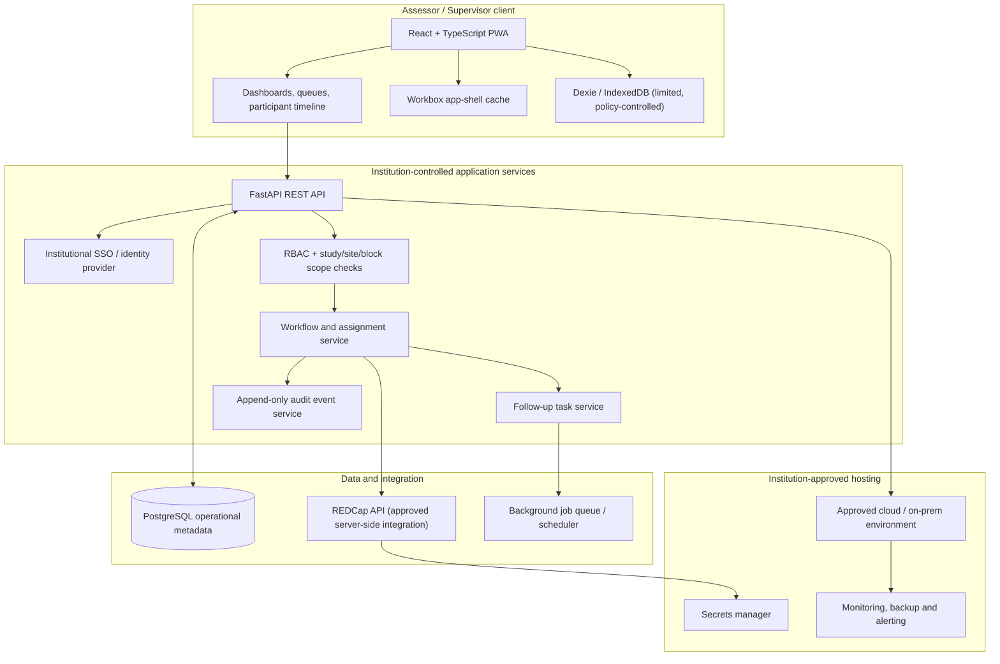

# FieldTrack System Architecture

> Status: Draft proposal. Validate with the research team, REDCap administrator, institutional IT/security and ethics/governance stakeholders before implementation.

## 1. Context and scope

FieldTrack is a universal operational workflow platform for research participant follow-up. A study administrator configures a study workflow and assigns assessors to sites, blocks or participant cohorts. Assessors work from assigned queues; supervisors review progress and workload.

The platform should coordinate operational activity without duplicating the study's authoritative clinical dataset.

## 2. Logical architecture

The diagram is conceptual. It does not imply that AWS, a particular AWS region, or any hosting provider has been approved.

## 3. Component responsibilities

### Web client
- Role-aware assessor and supervisor interfaces.
- Participant queues, filters, timelines and task lists.
- Explicit confirmation before changing participant workflow status.
- No embedded REDCap API credentials or privileged secrets.
- Only non-sensitive app-shell resources should be cached by default.

### API and application services
- Authenticate users through the institution-approved identity provider.
- Authorise every request against organisation, study, site, block and assignment scope.
- Validate state transitions against the configured workflow.
- Create callback tasks and preserve contact-attempt history.
- Expose only the minimum fields needed by each role.

### Operational database
PostgreSQL stores operational entities such as study configuration, assignments, pseudonymous participant references, workflow status, follow-up tasks and audit metadata. The exact boundary between FieldTrack and REDCap must be approved.

### REDCap integration
- Use an approved server-side integration account or approved user-scoped credentials.
- Keep credentials in a secrets manager or equivalent protected server configuration.
- Never expose tokens to browser code or assessor devices.
- Confirm REDCap project permissions, API scopes, rate limits, attribution and audit expectations with the REDCap administrator.
- Maintain FieldTrack's own actor-level audit events if REDCap records the integration account as the API actor.

### Background processing
A scheduler or queue worker can:
- Identify callbacks due today or overdue.
- Generate tasks from protocol-approved milestone dates.
- Send approved notifications, if notification channels and consent rules permit.
- Retry transient integration failures and surface permanent failures to administrators.

## 4. Deployment topology

Preferred deployment is within an environment approved by the institution. Production choices must be made with institutional IT/security.

Potential deployment units:
- Web frontend served over HTTPS.
- FastAPI application service.
- Background worker and scheduler.
- PostgreSQL database in a private network.
- Secrets manager.
- Centralised logs, monitoring and encrypted backups.
- Network controls limiting database and REDCap access to required services.

Use separate development, staging and production environments. Never use real participant data in developer laptops or public test environments unless explicitly authorised and protected.

## 5. API boundaries (illustrative)

| Resource | Example operations |
|---|---|
| Studies | list permitted studies; read workflow configuration |
| Assignments | list own assignments; supervisor create/reassign |
| Participants | list permitted pseudonymous records; view operational timeline |
| Contact attempts | append outcome, timestamp, assessor and optional operational note |
| Follow-up tasks | list due tasks; schedule, complete, cancel with reason |
| Visits | record operational milestone status and date |
| Reports | aggregate permitted operational metrics |
| Audit | restricted read access for authorised supervisors/auditors |

All endpoints require authentication and server-side scope checks. Never rely on frontend filtering as an access-control mechanism.

## 6. Key operational flows

### Contact attempt
1. Assessor opens a participant from their permitted queue.
2. The app launches the device dialler using a permitted phone action, if a phone number is available and policy allows it.
3. The assessor returns to the app and manually records the outcome.
4. The API appends a contact-attempt event.
5. If a callback is needed, the workflow service creates a dated follow-up task.
6. Dashboard counts update from the authoritative server state.

The PWA cannot reliably determine whether a call connected or was answered. The assessor must record the outcome; do not imply automatic call verification.

### Milestone completion
1. Assessor records a milestone or visit outcome.
2. Backend validates the transition and required fields.
3. An audit event is written.
4. If the approved workflow config defines a subsequent stage, the next task is generated.

### Supervisor reassignment
1. Supervisor selects a participant or assignment.
2. Backend verifies supervisor scope and reassignment permission.
3. Existing assignment history is retained.
4. New assignment and audit event are written.

## 7. Online-first and offline strategy

MVP should be online-first. PWA installability does not mean data is safely or reliably stored in a local folder.

If offline use is later required:
- Obtain explicit institutional approval for each category of locally stored data.
- Define device encryption, device management, local retention and remote revocation.
- Encrypt local sensitive records and protect keys using platform-supported secure storage.
- Define sync authentication, idempotency, conflict resolution and audit reconciliation.
- Do not cache sensitive REDCap responses in a generic service worker.
- Test shared-device logout, lost-device and storage-clearing scenarios.

If strong offline guarantees are essential, evaluate a managed native wrapper and encrypted SQLite rather than assuming browser storage is sufficient.

## 8. Non-functional requirements

- Security: least privilege, secure sessions, protected secrets, encryption in transit and at rest.
- Privacy: data minimisation, purpose limitation and approved retention.
- Reliability: backups, monitoring, retry handling and recovery procedures.
- Auditability: attributable and timestamped changes.
- Accessibility: usable on common tablets and low-bandwidth connections.
- Maintainability: documented APIs, automated tests, migrations and versioned workflow configuration.
- Scalability: tenant/study isolation and indexed queries for large participant cohorts.

## 9. Architecture decisions still open

See [Roadmap and open questions](ROADMAP_AND_OPEN_QUESTIONS.md). No production architecture should be treated as final until these decisions are approved.
