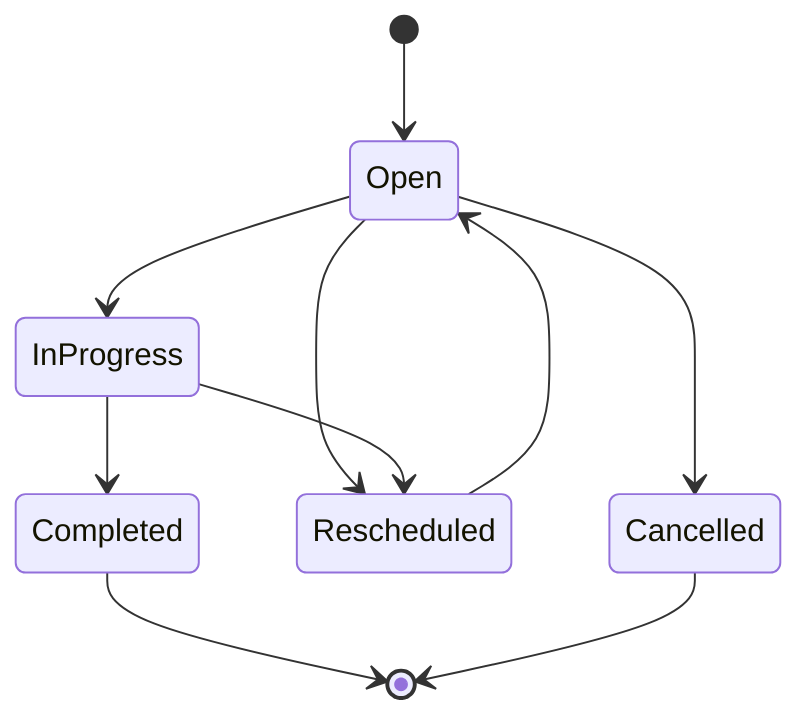

# Data Model and Workflow Draft

> This is a conceptual model. Final fields and identifiers must be reviewed against the study protocol, REDCap data dictionary and institutional governance rules.

## 1. Hierarchy

```text
Organisation
  └── Study
       ├── Workflow configuration
       ├── Site
       │    └── Block / catchment / unit (if applicable)
       ├── Team
       │    └── Assessor
       └── Participant
            ├── Assignment history
            ├── Contact attempt history
            ├── Follow-up tasks
            ├── Visit / milestone history
            └── Audit events
```

A participant belongs to a study and may have assignments over time. The assignment history must be retained when an assessor or block changes.

## 2. Core entities

| Entity | Purpose | Key considerations |
|---|---|---|
| Organisation | Tenant / institution boundary | Prevent cross-organisation access |
| Study | Research project configuration | Owns workflow configuration |
| Site | Hospital or research site | Belongs to one study |
| Block | Geographic or operational allocation | Optional, configurable |
| Team | Operational grouping | Supervisor and assessor membership |
| User / Assessor | Authenticated workforce identity | Link to institutional identity subject |
| Participant | Pseudonymous operational reference | Avoid unnecessary identifiers |
| Assignment | Participant-to-assessor allocation | Keep start/end and reassignment history |
| ContactAttempt | One attempted contact | Append-only history |
| FollowUpTask | A future action with due date | Track status, due date and completion |
| Visit / Milestone | Operational progress event | Protocol-defined stage |
| WorkflowConfig | Configurable statuses and transitions | Version configuration |
| AuditEvent | Who changed what and when | Restricted access and retention |

## 3. Suggested participant status model

The following is a starting point, not a protocol decision:

- Not yet attempted
- Attempted — no response
- Reached — unsure
- Interested
- Declined
- Callback scheduled
- Expected at hospital
- Attended / recruitment in progress
- Recruited
- Follow-up due
- Follow-up completed
- Withdrawn / ineligible (only where defined by protocol)

Avoid mixing a contact outcome with a participant's overall study status. For example, "no answer" is an outcome of one attempt, not necessarily the participant's permanent status.

## 4. Contact outcomes

Possible configurable outcomes:
- Interested
- Still unsure
- Not interested / declined
- No answer
- Asked to call later
- Number unavailable
- Other (with brief explanation)

Every attempt should record:
- Participant reference
- Assessor identity
- Attempt timestamp
- Outcome
- Optional short operational note
- Next action / callback due date, if applicable
- Creation source and sync metadata, if relevant

Do not overwrite prior attempts. Correct mistakes by adding a correction event or using a controlled amendment process.

## 5. Dashboard metric definitions

Metrics must have explicit definitions to avoid misleading counts.

| Metric | Definition |
|---|---|
| Assigned | Unique participants currently assigned to the assessor |
| Approached | Unique participants with at least one recorded approach attempt |
| Attempts | Total contact-attempt events, including repeat attempts |
| Reached | Unique participants with a successful human contact outcome |
| Interested | Unique participants whose current workflow status is interested |
| Unsure | Unique participants whose current workflow status is unsure |
| Due today | Open tasks with due date equal to the study/site-local current date |
| Overdue | Open tasks with due date before today |

The sum of status categories should be based on mutually exclusive current participant states. Attempts are a separate activity measure and must not be added to unique participant counts.

## 6. Follow-up task lifecycle



Each task should include:
- Task type and participant reference.
- Due date and time zone rule.
- Source milestone or workflow event.
- Assigned assessor or team.
- Status and completion timestamp.
- Completion outcome and actor.
- Reschedule/cancellation reason.

## 7. Milestone-based scheduling

Reminder intervals and milestone anchors must come from the approved study protocol. The 40-day follow-up example is not sufficiently defined yet: the team must confirm whether its anchor is birth date, recruitment date, survey date or another event.

Do not hard-code a 40-day interval or reminder sequence until approved. Store workflow rules as versioned configuration and retain which version generated each task.

## 8. Notes policy

Operational notes should be brief and structured where possible. Do not use free-text notes as a place to store clinical details, sensitive family information or unnecessary personal data. Define allowed note content, visibility, retention and correction rules with the study team.

## 9. Multi-study support

The platform should support multiple studies through configuration, but data must remain separated by organisation and study. A user may only access studies and sites explicitly granted by server-side permissions.

A generic workflow engine should not mean every study can freely customise every field. Each study's configuration must be approved, versioned and auditable.
